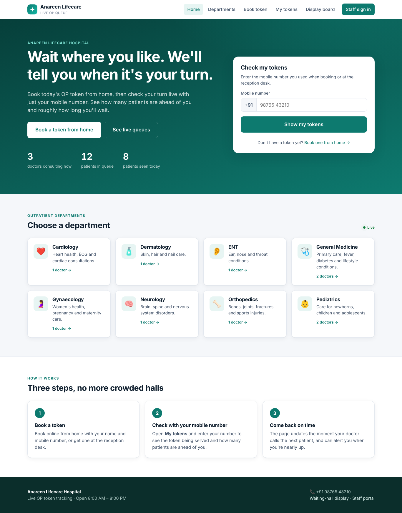
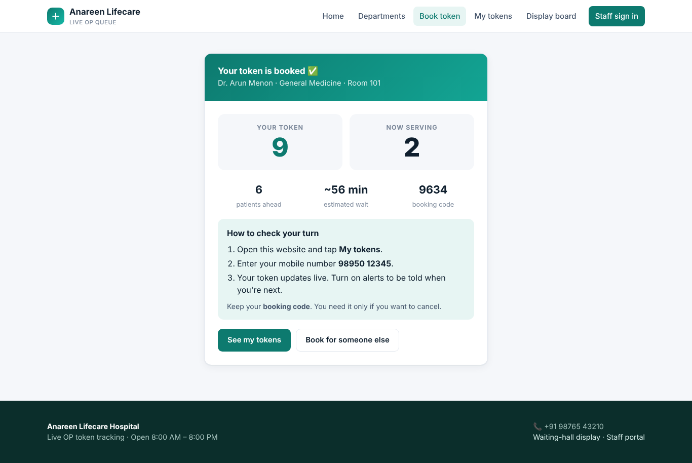
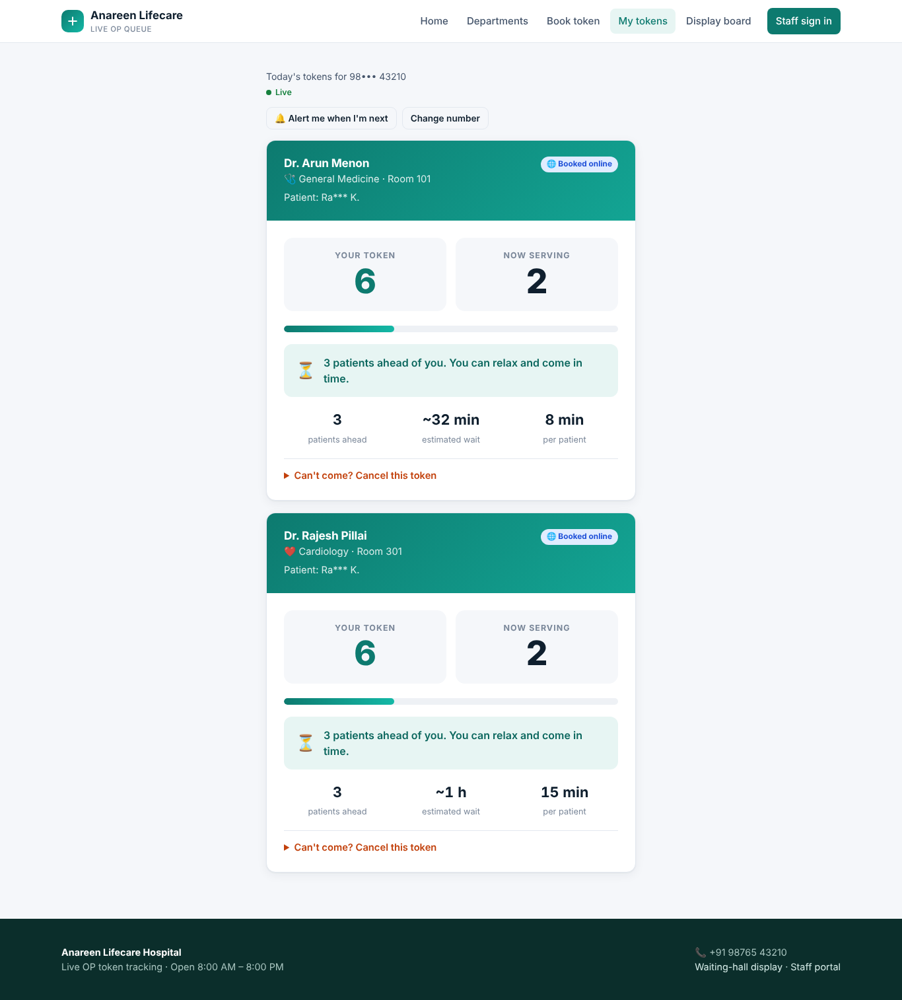
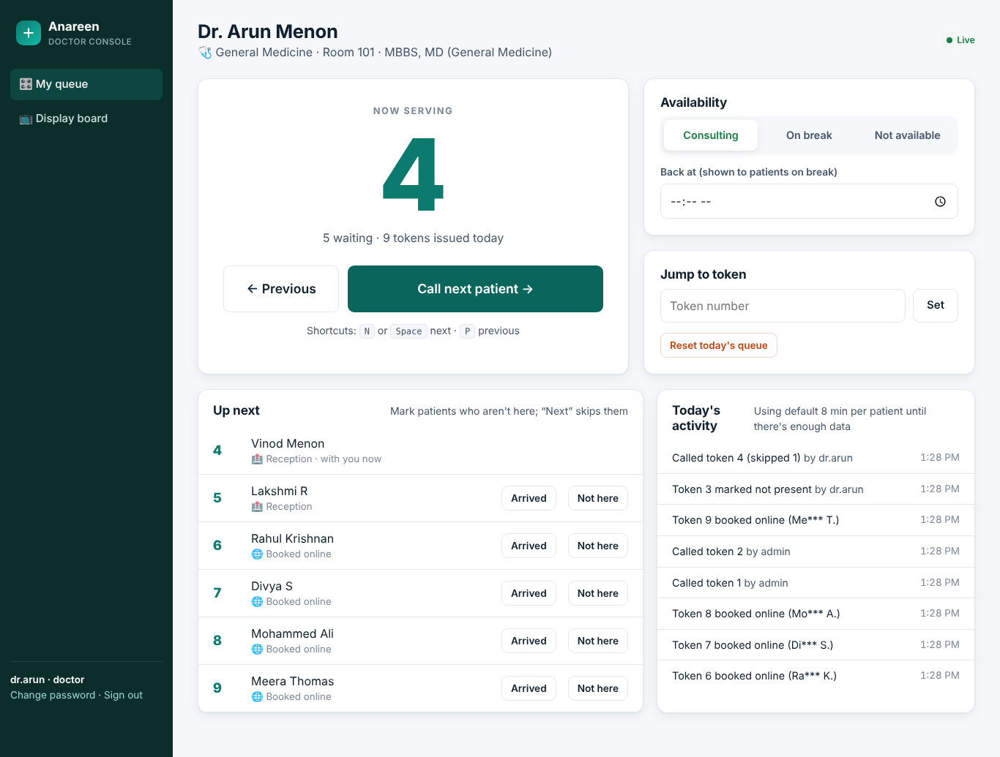
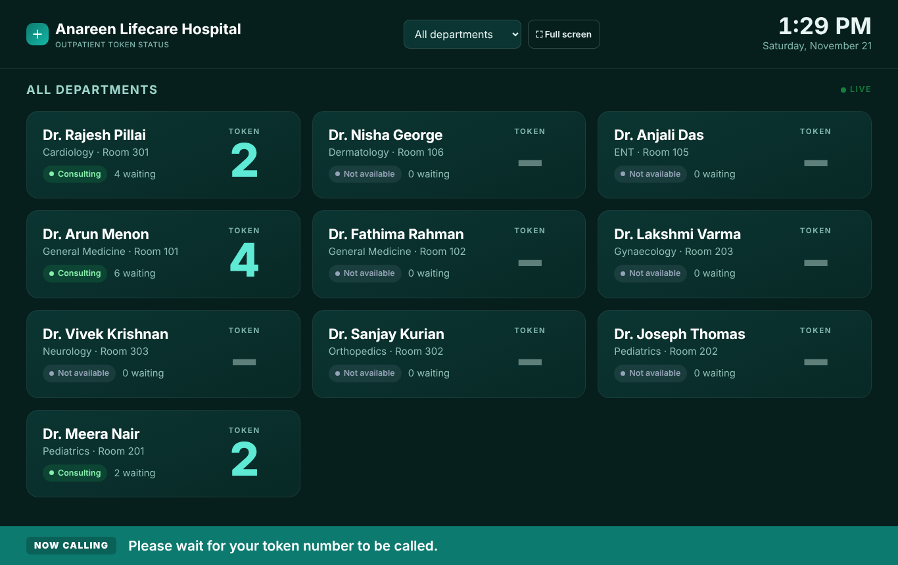
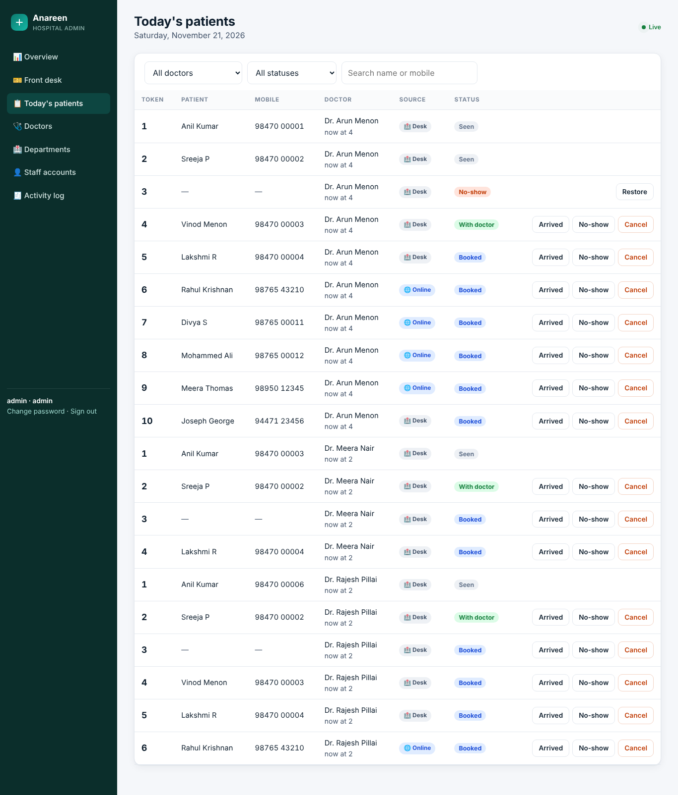
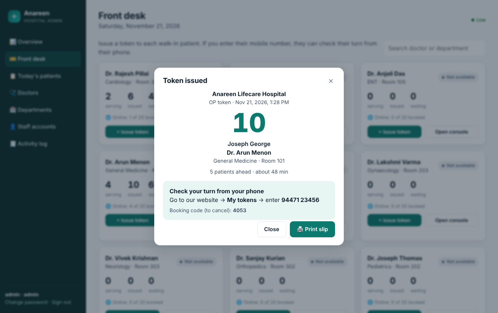
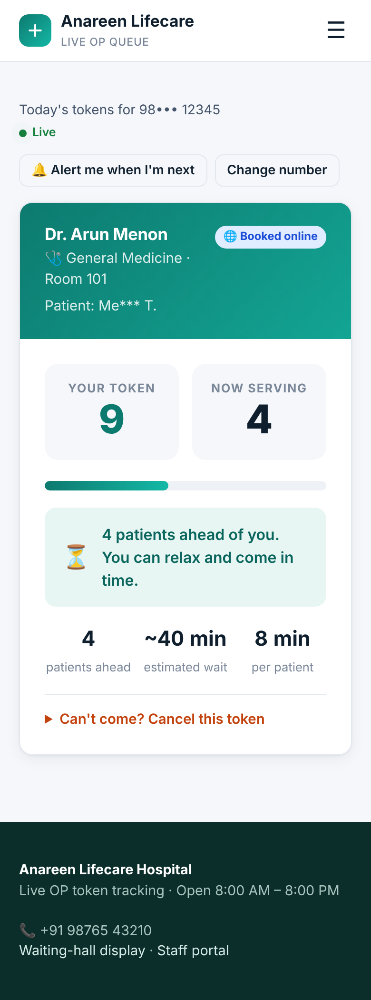
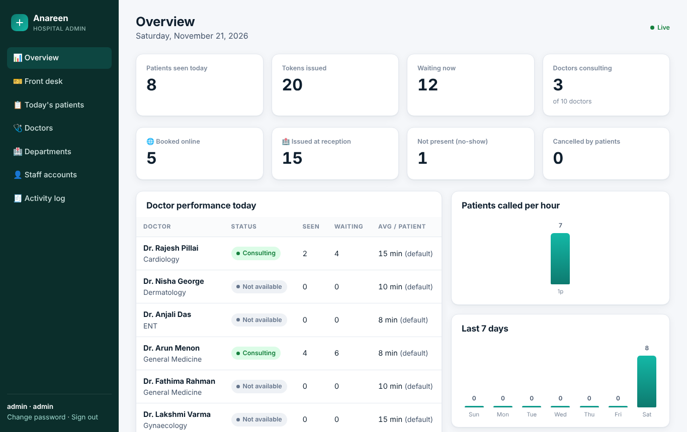

# Anareen Lifecare: Real-Time OP Token Tracking System

A full-stack web application that lets hospital outpatients **book an OP token from home** and **track it live using just their mobile number** instead of waiting in a crowded hall. Doctors call the next patient with one click, reception issues tokens to walk-in patients, and every screen updates instantly over WebSockets.



## The problem

In most Indian OP departments, patients get a token at the desk and then wait in the hall, often for hours, because they can't tell how far the queue has moved. Crowded halls spread infection, waste patients' time, and put pressure on reception staff who keep being asked "what number is going on?".

## The solution

| Who | What they get |
|---|---|
| **Patient** | Book today's token from home with name and mobile number. Later, open **My tokens**, enter the mobile number, and see every token they hold today: the token now being served, patients ahead, estimated wait, and an alert when they're next. They can cancel with a 4-digit booking code. |
| **Doctor** | A one-button console: **Call next patient** (or press `N`), go back, jump to a token, set status (consulting / on break until HH:MM / not available). An **Up next** list shows patients' names; tap **Not here** and "Next" skips them. |
| **Reception** | Issue tokens to walk-in patients (name and mobile optional) and print slips; a **Today's patients** list to mark people arrived, no-show or cancelled. |
| **Admin** | Manage departments, doctors (including online booking on/off and a daily online limit) and staff accounts; live analytics with online-vs-walk-in and no-show counts; a full activity log. |
| **Waiting hall** | A TV display board that flashes and **announces calls by voice** ("Token number 14, please proceed to Doctor Arun Menon, room 101"). |

## Features

- **Online booking from home** with fair-use rules: same-day only, within booking hours, one token per mobile number per doctor per day, and a daily online quota per doctor so walk-in patients still get a turn.
- **Track by mobile number. No link or QR code needed.** Online and walk-in tokens share one queue, and the patient's number finds all their tokens for the day. Names are masked on the public page (`Ra*** K.`) and the number is never sent back.
- **No-show handling**: cancelled and absent tokens are skipped automatically by "Next" and aren't counted as "patients ahead".
- **Real-time updates** with Socket.IO *rooms*: a change is pushed only to the screens watching that doctor or department. Nothing polls.
- **Wait-time estimation that learns.** It starts from each doctor's usual consultation time, then switches to the median of that day's actual gaps between "next" presses, ignoring breaks and double-clicks.
- **Role-based access control** with three roles (admin, reception, doctor). A doctor can control only their own queue.
- **Automatic daily reset**: queues start from 0 each day in the hospital's time zone, with no cron job needed.
- **Printable token slips** that tell the patient how to check their turn.
- **Voice announcements** on the display board (Web Speech API), in English or Malayalam.
- **English / മലയാളം switch** on every patient page and the display board, remembered on the device.
- **Privacy built in**: a plain-language [privacy notice](public/privacy.html), a required consent tick-box for online booking (optional at the desk), and the consent time stored with each booking.
- **Automatic data cleanup**: patient names and mobile numbers are deleted after `RETENTION_DAYS` (default 30); anonymous counts stay for analytics.
- **Daily database backups** with SQLite's online `VACUUM INTO`, checked for integrity, keeping the last 14 days; `npm run backup` makes one by hand.
- **Ready for a real deployment**: a health check that tests the database, timestamped error log file, HTTPS-only cookies in production, and correct behaviour behind nginx or another HTTPS proxy.
- **Patient alerts**: sound, vibration and browser notification when 1 patient is ahead.
- **Analytics**: patients seen, tokens issued, waiting now, per-doctor performance, calls per hour, and the last 7 days.
- **Audit trail** of every login, admin change and queue action.
- **Responsive**: works on phones, tablets, desktops and TVs. Respects reduced-motion settings.

## Tech stack

| Layer | Technology | Why |
|---|---|---|
| Runtime | Node.js 22.13+ | JavaScript on both client and server |
| Web framework | Express 5 | Minimal, widely used, native async error handling |
| Real-time | Socket.IO 4 | WebSockets with automatic reconnect and fallback |
| Database | SQLite (Node's built-in `node:sqlite`) | Zero setup, nothing to compile, ACID transactions; easy to swap for PostgreSQL |
| Auth | JWT in an httpOnly cookie + bcrypt | Stateless sessions; passwords never stored in plain text |
| Security | Helmet (CSP and other headers), rate limiting, input validation | Defence in depth |
| Frontend | HTML, CSS, vanilla JavaScript | No build step; easy to read and explain |
| Testing | Node's built-in test runner + Supertest | 69 automated tests |

## Getting started

```bash
# 1. Install (needs Node.js 22.13 or newer; check with `node -v`)
npm install

# 2. Configure
cp .env.example .env        # then set JWT_SECRET to a long random string

# 3. Run. Demo data is created automatically on first start
npm start                   # → http://localhost:3000

# Development mode (restarts on file changes)
npm run dev

# Run the test suite
npm test

# Wipe the database and reload demo data
npm run seed -- --reset

# Back up the database now (also happens automatically every day)
npm run backup
```

### Demo accounts

| Role | Username | Password |
|---|---|---|
| Admin | `admin` | `Admin@123` |
| Reception | `reception` | `Reception@123` |
| Doctor | `dr.arun`, `dr.meera`, `dr.rajesh`, … | `Doctor@123` |

Change these passwords before any real use (each user can do this from their dashboard).

### Try the live demo flow

1. **Patient at home:** open **/book**, choose General Medicine → Dr. Arun Menon, enter a name and a mobile number, and book. Note the token and the booking code.
2. **Walk-in patient:** in another window, sign in as `reception` → **Front desk** → **Issue token** for Dr. Arun Menon, with or without a mobile number.
3. **TV:** open **/display** and choose "Start with voice announcements".
4. **Doctor:** sign in as `dr.arun` in a third window. In **Up next** you'll see both patients. Press **N** a few times, or mark someone **Not here**.
5. **Patient's phone:** open **/track (My tokens)** and enter the same mobile number. Watch it update live along with the TV board.

> Online booking is open only between `BOOKING_OPEN` and `BOOKING_CLOSE` (default 06:00 to 19:00, hospital time). To demo it late at night, set both in `.env`, for example `BOOKING_OPEN=00:00` and `BOOKING_CLOSE=23:59`.

6. **Malayalam:** tap **മലയാളം** in the header (or **English** to switch back). For the TV, open `/display?lang=ml` once; the choice is remembered.

## Running a pilot

### Settings (`.env`)

| Variable | Default | What it does |
|---|---|---|
| `JWT_SECRET` | – | Long random string that signs staff logins. **Required** when `NODE_ENV=production`. |
| `NODE_ENV` | `development` | Set to `production` for the pilot: login cookies are then sent over HTTPS only. |
| `PORT` | `3000` | Port the app listens on. |
| `DB_PATH` | `data/anareen.db` | The SQLite database file. |
| `BOOKING_OPEN` / `BOOKING_CLOSE` | `06:00` / `19:00` | Online booking hours (hospital time). |
| `RETENTION_DAYS` | `30` | Patient names and mobile numbers are deleted from bookings older than this. Minimum 1. |
| `BACKUP_DIR` | `backups` | Where the daily backups go. |
| `BACKUP_KEEP` | `14` | How many daily backups to keep. |
| `LOG_FILE` | `logs/error.log` | Server errors are appended here with timestamps. Empty turns file logging off. |
| `TRUST_PROXY` | `1` | Number of HTTPS proxies in front of the app. Use `0` if visitors reach Node directly. |
| `FORCE_HTTPS` | `false` | `true` redirects plain-HTTP visits to HTTPS (not `/api/health`). |

### Every day, automatically

When the server starts, and then once each day (checked hourly in the hospital's time zone), it:

1. **Removes old patient details**: bookings older than `RETENTION_DAYS` lose their name and mobile number, and so do the matching queue-history lines. The booking rows stay, so analytics counts don't change. Each cleanup is written to the activity log as `privacy.cleanup`.
2. **Backs up the database** to `backups/anareen-YYYY-MM-DD.db` with `VACUUM INTO` (safe while the app is running), checks the copy with `PRAGMA quick_check`, and deletes all but the newest `BACKUP_KEEP` copies.

If either step fails, the error goes to the log file and the step is retried an hour later. Copy the `backups/` folder to another disk or cloud drive regularly: a backup on the same disk won't survive a disk failure.

**Restoring a backup:** stop the server, copy the backup over `data/anareen.db`, delete `data/anareen.db-wal` and `data/anareen.db-shm` if they exist, and start the server again.

### Health check and logs

- `GET /api/health` returns `200 {"ok":true,"database":"ok",...}` when the database answers, and `503` when it doesn't. Point an uptime monitor at it.
- Server errors (HTTP 500s, failed backups, crashes) go to `logs/error.log`, one timestamped entry each, e.g. `[2026-11-21T08:05:24.277Z] ERROR GET /api/book: …`. Query strings aren't logged, so mobile numbers don't end up in the log. The file rolls over to `error.log.1` at 5 MB.
- After an uncaught exception the process exits (after logging), so run it under a process manager that restarts it: `pm2`, a `systemd` service with `Restart=always`, or Docker with `restart: always`.

### HTTPS behind a reverse proxy

Run Node on the clinic server and let nginx (or Caddy, or a cloud load balancer) handle HTTPS:

```nginx
server {
  listen 443 ssl;
  server_name opd.example-clinic.in;
  # ssl_certificate / ssl_certificate_key from Let's Encrypt (certbot)

  location / {
    proxy_pass http://127.0.0.1:3000;
    proxy_http_version 1.1;
    proxy_set_header Upgrade $http_upgrade;        # needed for Socket.IO live updates
    proxy_set_header Connection "upgrade";
    proxy_set_header Host $host;
    proxy_set_header X-Forwarded-For $proxy_add_x_forwarded_for;
    proxy_set_header X-Forwarded-Proto $scheme;    # tells the app the visit was HTTPS
  }
}
```

With `NODE_ENV=production`, `TRUST_PROXY=1` and `FORCE_HTTPS=true`, the app redirects plain HTTP to HTTPS, marks login cookies `Secure`, and rate-limits by the visitor's real IP address. Helmet already sends `Strict-Transport-Security`.

### Before the pilot

- Change every demo password (or create fresh accounts and delete the demo ones).
- Have the clinic check the [privacy notice](public/privacy.html) (contact number, retention period) against India's Digital Personal Data Protection Act, 2023. This README isn't legal advice.
- Have a native Malayalam speaker read through `public/js/i18n.js`. The translations are careful but haven't been reviewed by one yet.
- For Malayalam voice announcements, the TV's browser needs a Malayalam text-to-speech voice (Microsoft Edge and Chrome on Android usually have one). Without one, the board shows a notice and announces in English.

## Pages

| URL | Page | Access |
|---|---|---|
| `/` | Home: live stats, departments, quick token tracker | Public |
| `/department?d=<slug>` | Live doctor cards for a department | Public |
| `/book?doctor=<id>` | Book today's token from home | Public |
| `/track` | **My tokens**: look up by mobile number (or by doctor + token number) | Public |
| `/display?d=<slug>` | Waiting-hall TV board with voice | Public |
| `/privacy` | Privacy notice in simple English and Malayalam | Public |
| `/login` | Staff sign-in | Public |
| `/doctor` | Doctor console | Doctor (or staff with `?id=`) |
| `/admin` | Admin and front-desk dashboard | Admin, reception |

## Project structure

```
anareen-lifecare/
├── src/
│   ├── server.js            # Entry point: HTTP + Socket.IO server
│   ├── app.js               # Express app factory (used by server and tests)
│   ├── config.js            # Environment configuration
│   ├── realtime.js          # Socket.IO rooms and broadcasting
│   ├── maintenance.js       # Daily privacy cleanup + backup
│   ├── logger.js            # Timestamped error log file
│   ├── db/
│   │   ├── schema.sql       # Tables, constraints, indexes
│   │   ├── index.js         # Opens DB, applies schema
│   │   ├── seed.js          # Demo departments, doctors, accounts
│   │   └── backup.js        # VACUUM INTO backups (npm run backup)
│   ├── services/
│   │   ├── queue.js         # All token and queue business logic
│   │   └── retention.js     # Deletes old patient names and numbers
│   ├── routes/
│   │   ├── auth.js          # Login, logout, me, change password
│   │   ├── public.js        # Departments, doctors, booking, my-tokens, cancel
│   │   ├── queue.js         # Next / previous / set / issue / status / reset / upcoming
│   │   ├── bookings.js      # Staff: arrived / no-show / cancel / restore
│   │   └── admin.js         # CRUD, users, stats, audit log
│   └── middleware/          # auth, validation, rate limit, errors
├── public/                  # Frontend (HTML, CSS, JS); js/i18n.js holds the Malayalam
├── tests/                   # API and real-time tests
└── docs/                    # Architecture, API reference, screenshots
```

## Documentation

- [Architecture and design](docs/ARCHITECTURE.md): system diagram, ER diagram, sequence diagram, design decisions
- [API reference](docs/API.md): every endpoint with request and response formats

## Screenshots

| Book from home | My tokens (by mobile number) |
|---|---|
|  |  |
| **Doctor console with "Up next"** | **TV display board** |
|  |  |
| **Today's patients (reception)** | **Walk-in token slip** |
|  |  |
| **My tokens on a phone** | **Admin analytics** |
|  |  |

## Future scope

- **OTP verification of mobile numbers** at booking (needs a paid SMS gateway such as MSG91 or Twilio). Today a made-up number can still book; the daily quota and one-token-per-number rule limit the damage.
- SMS / WhatsApp alert when a patient is 2 tokens away
- Booking for future dates and time slots
- Hindi and Tamil interface and voice announcements; Malayalam for the staff screens
- Progressive Web App with push notifications
- PostgreSQL + Redis adapter for running several server instances
- Integration with a hospital information system (HL7 / FHIR)

## License

MIT
