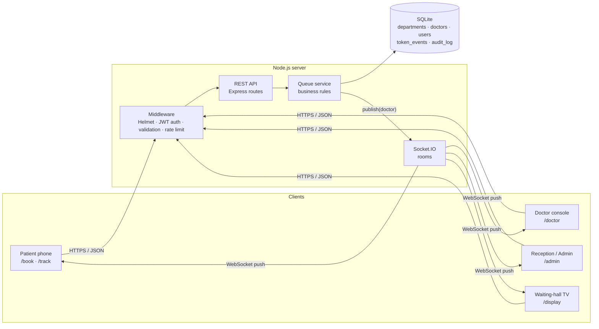
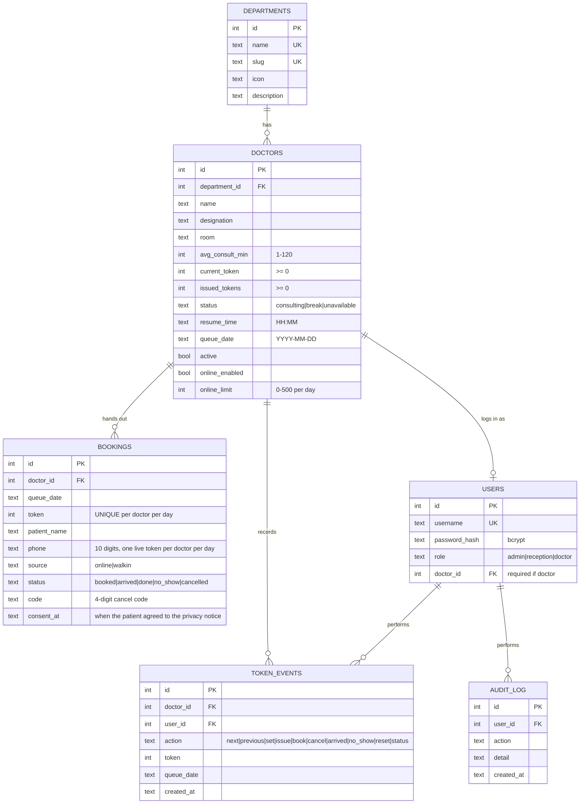
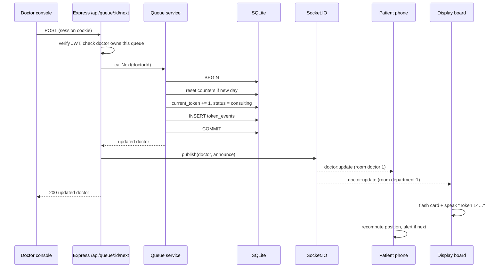

# Architecture and design

## 1. System architecture



It is a three-tier design: presentation (static HTML/JS), application (Express + Socket.IO), and data (SQLite).

- **Routes** only parse input and check permissions.
- **The queue service** (`src/services/queue.js`) owns every rule: what "next" means, daily reset, wait estimates. That keeps the rules in one place and makes them easy to test.
- **The real-time layer** is injected into the app as a `publish()` function, so tests can run the full API with no sockets.
- **Daily maintenance** (`src/maintenance.js`) runs beside the web server: it removes old patient details (`src/services/retention.js`) and backs up the database (`src/db/backup.js`).

## 2. Database design (ER diagram)



**Bookings.** Every token handed out, online or at the desk, gets a `bookings` row, so both kinds share one numbering sequence. The rule "one live token per mobile number per doctor per day" is a **partial unique index** (`WHERE phone IS NOT NULL AND status <> 'cancelled'`), so even two simultaneous requests can't break it.

The schema is in third normal form. Integrity is enforced **in the database itself** through `CHECK`, `UNIQUE` and foreign-key constraints, not only in application code. For example, a user with role `doctor` *must* have a `doctor_id`.

`token_events` is an append-only event log. It drives three features with no extra tables: the doctor's live history, the learned average consultation time, and analytics.

## 3. Key flow: doctor calls the next patient



## 4. Algorithms

### Patients ahead and estimated wait
```
skipped = tokens marked cancelled or no_show
if token is skipped → "cancelled" / "no_show"
if token <  current → "passed"
if token == current → "now"
else ahead = token − current − 1 − |skipped tokens between current and token|
     eta   = (ahead + 1) × avgMinutes        (ahead × avg if nobody called yet)
```

### Calling the next patient
`next = current + 1`, then keep adding 1 while `next` is skipped. The booking for the old current token is marked `done`.

### Online booking rules (checked inside one transaction)
1. The doctor is active and has online booking switched on.
2. The time is between `BOOKING_OPEN` and `BOOKING_CLOSE` (hospital time zone).
3. Online bookings today are below the doctor's `online_limit`.
4. The mobile number doesn't already hold a live token for this doctor today.
5. Token = `max(issued, current) + 1`; a random 4-digit cancel code is generated.

### Tracking by mobile number
`GET /api/my-tokens?phone=` returns today's non-cancelled bookings for that number, each with its live position. The response never contains the phone number, and names are masked. Cancelling needs the number **and** the 4-digit code, so knowing someone's number isn't enough to cancel their token.

### Learned average consultation time
1. Take today's last 11 `next` events for the doctor → 10 time gaps.
2. Discard gaps under 1 minute (double clicks) or over 90 minutes (lunch, breaks).
3. If at least 3 gaps remain, use their **median** (robust to outliers); otherwise use the doctor's configured average.

### Data retention (privacy cleanup)
```
cutoff = today − RETENTION_DAYS            (hospital time zone)
UPDATE bookings     SET patient_name = NULL, phone = NULL     WHERE queue_date < cutoff
UPDATE token_events SET detail = 'walk-in' / 'online'         WHERE queue_date < cutoff AND action IN ('issue','book')
```
The rows are kept, so every count (patients per day, online vs walk-in, no-shows) is unchanged; only the link to a person is gone. It runs in one transaction, is idempotent, can never touch today's live queue (`RETENTION_DAYS` ≥ 1), and records a `privacy.cleanup` line in the audit log. Bookings store `consent_at`, the time the patient ticked the consent box. It's required online and optional at the desk.

### Backups
`VACUUM INTO 'backups/anareen-YYYY-MM-DD.db.partial'` writes a consistent copy while the app keeps serving requests. The copy is opened read-only and checked with `PRAGMA quick_check`, then renamed into place, so a half-written file never looks like a backup. Only the newest `BACKUP_KEEP` files matching `anareen-YYYY-MM-DD.db` are kept; other files in the folder are left alone.

### Scheduling the daily jobs
On startup and then every hour, the maintenance job compares today's date with the date it last succeeded. It runs only when they differ. A restart doesn't make a second backup for the same day, a missed day is caught up on the next start, and a failed step is retried an hour later.

### Daily reset without a scheduler
Each doctor row stores `queue_date`. Every read or write first runs
`UPDATE … SET current_token = 0, issued_tokens = 0 WHERE queue_date <> today`.
This is idempotent, needs no cron job, and survives server restarts.

## 5. Security

| Threat | Mitigation |
|---|---|
| Password theft | bcrypt hashing (cost 10); passwords are never logged or returned |
| Session theft by XSS | JWT stored in an **httpOnly** cookie that scripts cannot read |
| XSS | Every value is HTML-escaped before rendering; a strict Content-Security-Policy blocks inline scripts |
| CSRF | `SameSite=Strict` cookie plus a JSON-only API |
| Brute-force login | 5 failed attempts per IP per 15 minutes → HTTP 429 |
| Booking spam | 10 bookings per IP per hour; per-doctor online quota; one token per number per doctor per day |
| Looking up others' tokens | Lookup is rate-limited; names masked; number not echoed back; cancel needs a secret code |
| Username enumeration | Same error and same bcrypt work whether or not the user exists |
| Privilege escalation | Role checks on every route; doctors are limited to their own queue |
| SQL injection | Parameterised prepared statements only |
| Bad input | Server-side validation of type, range and length; body size limit of 20 KB |
| Leaked secrets | Configuration through `.env` (git-ignored); the server refuses to start in production without `JWT_SECRET` |
| Keeping personal data too long | Names and numbers deleted after `RETENTION_DAYS`; consent recorded; backups kept only `BACKUP_KEEP` days |
| Cookie sent over plain HTTP | `Secure` cookie flag in production; `trust proxy` so `req.secure` is right behind nginx; optional `FORCE_HTTPS` redirect; HSTS header |
| Personal data in logs | Error log records method and path only, never query strings (which can hold mobile numbers) or request bodies |
| Data loss | Daily integrity-checked `VACUUM INTO` backups; health check reports a broken database with HTTP 503 |

## 6. Design decisions

- **SQLite over Firebase/MongoDB.** Version 1 mixed Firebase and MongoDB and needed cloud credentials just to run. SQLite needs no setup, gives real transactions (so token numbers can never be issued twice), and the SQL is portable to PostgreSQL.
- **Push over polling.** Version 1 polled every 5 seconds: 12 requests per minute per open screen, and up to 5 seconds of delay. Socket.IO pushes in milliseconds and only to interested rooms.
- **Vanilla JS frontend.** There's no build step, so every line can be explained in a viva. The structure (shared `common.js`, one script per page) would map directly onto React components later.
- **App factory pattern.** `createApp({ db, publish })` makes the whole HTTP layer testable with an in-memory database.
- **Translations without a framework.** English stays in the HTML and in the page scripts (`t("key", "English text")`); `public/js/i18n.js` holds only Malayalam. A missing translation therefore shows English instead of a blank or a key name. Staff pages don't load `i18n.js` and stay in English. The server keeps sending English messages, plus a `reason` code for booking availability; the patient pages translate both.
- **Malayalam speech falls back to English.** Browsers without a Malayalam voice read Malayalam script badly or not at all, so the display board speaks English instead and tells staff how to add a Malayalam voice.

## 7. Testing

`npm test` runs 69 automated tests covering:

- public endpoints and input validation
- authentication, cookie flags, rate limiting, password change
- queue rules: issue order, next/previous bounds, set validation, status, history, manual and automatic daily reset
- permissions: a doctor cannot touch another doctor's queue; reception cannot manage doctors
- admin CRUD, constraint errors (409), stats totals, audit log
- online booking: validation, one-per-number, shared numbering with walk-ins, masked lookup, cancel code, quota, switch-off, booking hours
- no-show and cancelled tokens are skipped and not counted as "ahead"
- upgrading a database from the previous version without losing data (v2.0 and v2.1)
- Socket.IO: an update reaches the watching room and **not** other rooms
- consent: required and recorded online, optional at the desk; the privacy page and published retention period
- retention: old names and numbers removed, recent and today's kept, counts unchanged, idempotent, audit line, bad settings refused
- backups: complete readable copy of a live WAL database, one per day, keep-14 pruning, `npm run backup`
- daily maintenance: runs at startup, not twice a day, retries after a failure
- operations: health check returns 503 when the database is down, timestamped error log without mobile numbers, `Secure` cookies in production, `FORCE_HTTPS` redirect via `X-Forwarded-Proto`, HSTS
